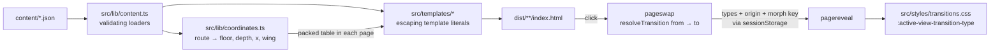

# DMNS · Z-space concept

A concept redesign of the Denver Museum of Nature & Science website: the museum at night, navigated
through depth. Entering a hall dollies forward through a doorway, Back steps out, sibling halls walk
sideways, and changing floors rides the stairwell. It's a static multi-page site in strict TypeScript
compiled to native ES modules, with light-DOM custom elements. Motion comes from View Transitions and
scroll-driven CSS. There is no framework or bundler, and nothing runs at runtime beyond about 13 KB gzip
of modules.

This is not the official DMNS site. Ticketing, membership, donations, login, search, Catalyst and Digital
Collections link out to dmns.org.

## Run

Node 22+.

```sh
npm ci
npm run build      # tsc → .build/, then scripts/build.ts → dist/
npm run dev        # build + static server on http://localhost:4321
npm run check      # tsc, eslint, unit, contrast, budgets, links, Playwright + axe
```

- Notices expire by build date (America/Denver), so rebuild daily on deploy. `BUILD_DATE=YYYY-MM-DD npm run build` pins the date.
- Deploy `dist/` as its own Netlify site with base directory `dmns-z-space` (see `netlify.toml`). The
  repository-root `netlify.toml` belongs to the concept-review example.
- Walkthrough recording: `npx serve dist -l 4321 &` then `node .build/scripts/record-walkthrough.js`
  (writes `dist-media/walkthrough.webm`).

## Architecture



```
route ──► RoutePosition { floor, depth, x, wing, spans? }
from, to ──► resolveTransition ──► 'enter' | 'exit' | 'lateral-l' | 'lateral-r' | 'ascend' | 'descend' | 'reload'
                                    (same path → floor change → depth change → lateral)
type ──► viewTransition.types ──► html:active-view-transition-type(type)::view-transition-old/new(root)
```

| Layer | Files |
|---|---|
| Data | `content/*.json` (single source; unknown copy is `TODO: confirm with DMNS`) |
| Pure logic | `src/lib/` coordinates, resolve-transition, dates, motion, color, content loaders |
| Build-time rendering | `src/templates/`, `scripts/build.ts` |
| Render-blocking runtime | `src/z-space.ts` → `src/dom/page-transitions.ts` (pageswap / pagereveal) |
| Deferred runtime | `src/main.ts` → `src/components/*` (one custom element per file) |
| Motion | `src/styles/transitions.css`, `src/styles/scroll.css`; spec in `docs/motion-spec.md` |
| Checks | `scripts/check-*.ts`, `tests/unit`, `tests/e2e` |

Custom elements: `dmns-header`, `dmns-minimap`, `dmns-doorway`, `dmns-floorplan`, `dmns-vitrine`,
`dmns-notice`, `dmns-event-corridor`, `dmns-sealed-hall`, plus `dmns-filter` for the gallery filter. All
render meaningful HTML at build time. With JavaScript off, every page is fully navigable.

## Decisions that differ from or sharpen the brief

- **The Directory spans floors 1–3.** With "floor change wins", Directory → Prehistoric Journey would be
  `ascend`, which contradicts §14. The Directory shows every floor, so it carries `spans: [1, 2, 3]`.
- **Physical camera signs.** Walking right slides the room left; climbing slides the room down.
- **Gold as a line uses `--signal`.** DMNS gold fails 3:1 as a focus ring on Daylight surfaces, so rings
  and "you are here" marks use a deepened gold there (generated audit: `docs/contrast.md`).
- **Labels scale but never fade on scroll,** so text keeps full contrast at every scroll position.
- **Newsreader ships as two instanced files** (display at opsz 72, text at opsz 16). One variable file with
  both axes was 126 KB.
- **The filter keeps focus on the pressed toggle** and announces the count, rather than jumping focus to a
  heading the filter doesn't have. Floor switching does move focus to the new floor heading, as specified.

## Open `TODO: confirm with DMNS` items

Each renders as a dashed, visibly marked placeholder. `scripts/check-links.ts` fails the build if TODO text
appears outside a marker.

| Where | Item |
|---|---|
| `site.json` footer | Exact land acknowledgment wording. dmns.org blocks this build environment, so it wasn't copied. Must not be paraphrased. |
| `site.json` visit | Accessibility, Getting here, Eat & shop copy |
| `site.json` pages | School Programs, About and Support ledes; Programs item descriptions; Behind the Glass topic copy |
| `halls.json` | Gems and Minerals floor; object names, metadata and label text for vitrine plates |
| `exhibitions.json` | Descriptions for all four exhibitions/events |
| `theaters.json` | Gates Planetarium and Laser Shows descriptions |
| `events.json` | All upcoming events (four placeholder slots) |
| `media.json` | Every image: real DMNS photography, alt text and credits (all plates are placeholders) |
| Brand | Official DMNS logo file (the header uses a text wordmark until it's supplied) |
